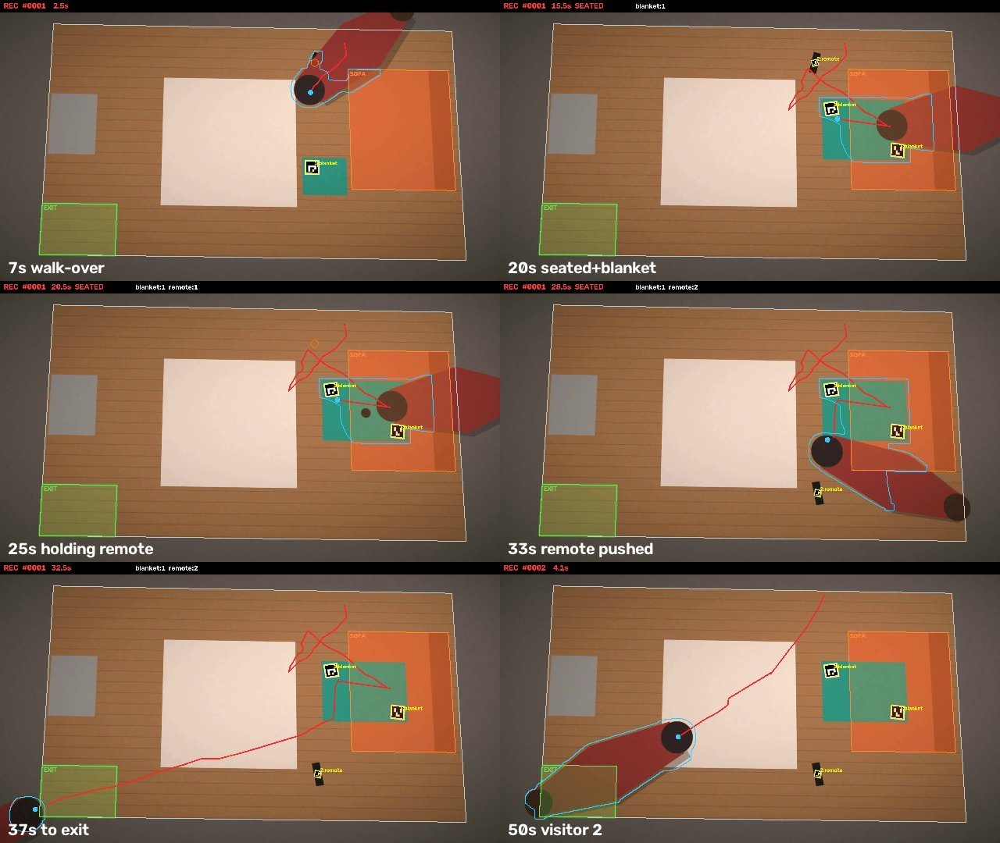

# CCTV 인터랙션 (시연용) — 사용 설명서

천장(위)에서 내려다본 카메라 화면 하나로
**사람 동선 · 소파에 앉음 · 담요/리모컨 변화 · 출구 퇴장**을 알아채고,
언리얼 블루프린트로 신호(OSC)를 보내고, 퇴장하면 **결과 QR**을 만든다.

```
카메라(A7 IV, USB 스트리밍) → home_tracker.py → OSC → Unreal 블루프린트(소리·볼륨·화면)
                                         └→ results/latest_qr.png (출구 화면 QR)
```

## 0. 준비물
| 무엇 | 메모 |
|---|---|
| 카메라 | A7 IV + 24-70mm를 **24mm**로. USB-C로 맥에 연결 → 카메라 화면의 USB 메뉴에서 **Live Stream (USB 스트리밍)** |
| 거치 | 바닥을 위에서 내려다보게 (C스탠드+그립암+모래주머니). 사람 머리보다 높게, **2.4m 이상** 권장 |
| 마커 | `markers_A4.pdf`를 **실제 크기(100%)** 로 인쇄 → 담요 두 모서리(ID 1·3, 10cm), 리모컨 윗면(ID 2, 5cm) |
| 맥 | 터미널에서 한 번만: `pip3 install -r requirements.txt` |

**카메라 설정 (꼭 고정)**: MF로 바닥에 초점 · M 모드, 셔터 1/60 또는 1/120 · ISO 고정 · 화이트밸런스 3500K 근처 고정 · 절전 끄기, 자동 꺼짐 온도 '높음'.
카메라가 알아서 바꾸는 값이 있으면 화면이 바뀐 걸 사람으로 착각한다.

24mm일 때 바닥에 찍히는 넓이 ≈ **가로 = 높이 × 1.5, 세로 = 높이 × 0.84** (예: 2.4m → 3.6 × 2.0m).
USB 스트리밍에서 화면이 크롭되면 이보다 좁아지니 처음 연결할 때 확인.

## ★ 한 번에 실행 + 자동 시연 기록 (11/19 23시)
- **더블클릭**: 저장소 맨 위 `시연시작.command` (게임식 시연) / `카메라시연.command` (천장 카메라). 터미널에서는 `python3 home_mouse.py` · `python3 home_tracker.py` 그대로.
- **한 화면 분할 (11/19 23:30)**: 게임식 시연은 화면 크기를 재서 왼쪽에 언리얼 게임 창(16:9), 오른쪽에 시연 창(화면의 약 42%, 비율 유지 축소)을 띄움. `unreal_game.layout`을 "manual"로 하면 `res`·`pos`를 그대로 씀, `panel_ratio`로 오른쪽 비율 조절.
- **게임 키 C = 소파 앉기/일어나기**: 소파 60cm 안에서 누르면 소파 가운데에 앉아 TV를 봄 → 1.2초 뒤 `/home/sit 1` → 언리얼 조명 켜짐 + 관객 눈높이 115cm·시선 -14°. 앉아 있는 동안 WASD 막힘(고개만). 다시 C → 소파 앞으로 일어남(160cm).
- **관리자 소리 계기판 (11/19 23:50)**: 감독 모니터 = 언리얼 화면 왼쪽(천장 CCTV). 0.5초마다 `/home/meter`로 각 소리 단계 0~5(MUSIC·TV·FIRE)와 겹침 단계 0~5(CALM → MILD OVERLAP → UNCOMFORTABLE → UNPLEASANT)를 보내 화면 왼쪽 위에 표시. 언리얼 OSC 글자는 한글이 깨져서 영어로.
- **테스트 채널**: PL_TV = TEST_CH1(따뜻한 저녁)·CH2(9시 뉴스)·CH3(통통 만화)·B_home·A_society. TV 켜면 CH1, 리모컨 누를 때마다 다음 (언리얼은 `/home/touch remote 횟수`의 횟수 % 채널 수 번을 엶). 미리보기 `docs/test_channels_1119.png`.
- 실행하면 **언리얼이 게임 창으로 같이 켜짐** (`unreal_game.py`, 에디터 ▶ 필요 없음, 맵 L_Current, 화면 2분할 그대로). 준비(OSC 8000 열림)까지 기다렸다가 시작, 끝나면 언리얼도 닫힘 (오류로 끝나도 `atexit`).
  - 에디터에서 이미 ▶ 플레이 중이면(8000 포트 사용 중) 새로 켜지 않고 그걸 씀. 따로 켜려면 `--no-unreal`.
  - 설정(선택) `config.json` → `"unreal_game": {"app": ..., "project": ..., "map": ..., "res": [1280, 720], "pos": [0, 30], "ready_timeout_s": 240}`. 게임 창은 마우스를 붙잡지 않게 띄움.
- **시연 기록**: 켤 때마다 `results/mouse/sessions/<날짜_시각>/` (카메라는 `results/sessions/…`) 폴더가 생기고, 끝나면 `시연기록.html`이 자동으로 열림. `--no-record`로 끔.
  - `시연기록.html` 관객 수·평균 머문 시간·관객별 (입장 시각·머문 시간·만진 물건·앉음·소리 세 갈래 초·동선 그림·QR·결과 페이지 링크)·시연 영상
  - `시연화면.mp4` 시연 창 녹화 15fps (mp4v — Chrome에서 안 나오면 QuickTime·Safari) · `로그.txt` · `신호.csv`(OSC, 위치·방향은 0.25초마다) · `동선_0001.png` · `qr_0001.png` · `visit_0001.json` · `언리얼로그.txt`
  - 관객이 나갈 때마다 페이지가 갱신돼서 시연 중에도 열어 볼 수 있음.
- 11/19 맥에서 시험: 언리얼 준비 7~8초, 걷기·앉기(조명)·TV·담요·퇴장 QR → 끝내면 언리얼 닫힘·기록 열림 확인. ⚠️ 맥 OpenCV의 avc1(H.264) 녹화는 프로그램을 죽여서(Segmentation fault) mp4v만 씀.

## 1. 현장 설정 (공간이 바뀔 때마다)
```bash
cd interaction
python3 home_tracker.py --list-cameras        # 카메라 번호 확인 (A7 IV가 몇 번인지)
python3 home_tracker.py --setup --camera 1    # 화면을 클릭해서 설정
```
1. **바닥 네 모서리**를 좌상 → 우상 → 우하 → 좌하 순서로 클릭 → 터미널에 그 사이 가로·세로 길이(cm) 입력
2. **소파 영역** 꼭짓점들 클릭 → ENTER
3. **출구 영역** 꼭짓점들 클릭 → ENTER (손·사람이 3초 머물 수 있게 넉넉한 사각형으로)
→ `config.json`에 저장된다. (z: 마지막 점 취소 · ESC: 취소)

카메라가 바로 아래가 아니라 비스듬히 보고 있으면 `config.json`의 `nadir_px`에 **카메라 바로 아래 바닥 지점의 화면 좌표**를 적어 주면 위치가 더 정확해진다(비우면 화면 가운데).

## 2. 실행
```bash
python3 home_tracker.py --camera 1            # 인식 화면이 뜨고, 언리얼로 OSC 전송
```
- 처음 몇 초는 **아무도 없는 상태**에서 켜기(빈 공간을 배경으로 기억). 꼬였으면 사람 없을 때 `b`.
- 화면: 하늘색 테두리 = 사람, 파란 점 = 발 위치, 빨간 선 = 동선, 노란 네모 = 마커, 주황 원 = 사라진 마커의 원래 자리.
- 키(CCTV 창을 클릭한 뒤): `ESC`·`q` 종료 · `b` 배경 다시 찍기 · `r` 지금 관객 강제 종료 · `s` 화면 저장 (한글 입력 상태면 ESC만 됨). 창 닫기·터미널 Ctrl+C로 꺼도 기록 저장

### 위치로 삼는 점 (`config.json` → `tune` → `point_mode`)
| 값 | 언제 |
|---|---|
| `foot` (기본) | 위에서 사람을 찍을 때. 원근으로 몸이 늘어져 보이므로 카메라 바로 아래에 가장 가까운 끝 = 발 |
| `tip` | 책상 위에서 손으로 시험할 때. 화면 가장자리(팔 쪽)에서 가장 먼 끝 = 손끝 |
| `center` | 덩어리 중심 |

### 판단 규칙 (`config.json`의 `tune`에서 숫자 조절)
| 사건 | 언제 |
|---|---|
| 입장 | 바닥 영역 안 어디든 사람(손)이 0.8초 이어서 보이면 자동 (`entry_anywhere`) |
| 소파 앉음 / 일어남 | 발 위치가 소파 영역에 1.2초 / 영역에서 35cm 넘게 1.5초 벗어남 |
| 물건 만짐 | 마커가 12cm 넘게 옮겨짐 · 사람에 안 가려졌는데 1초 넘게 안 보임(집어 감) · **멈춰 있는** 사람 아래에서 4초 넘게 안 보임(들고 있음) |
| 만짐 아님 | 지나가며 잠깐 가렸다가 같은 자리에서 다시 보임 |
| 퇴장 | **출구 영역 안에 3초** 머묾 (`exit_dwell_s`) → QR 창이 자동으로 뜸 (20초, 다음 관객 입장 시 닫힘). 출구 근처에서 사라져도 1.5초 뒤 퇴장, 다른 곳에서 사라지면 10초 |
| 지하철 칸 | 지하철 구역에 들어오면 (관객마다 한 번, 집에 들어가기 전만) → `/home/train` (지하철 소리) |
| 집에 들어옴 | 집 구역(언리얼 도면)에 0.4초 머묾 → `/home/door` (지하철 소리 2초에 걸쳐 잦아듦) |
| TV 켜기 | TV 앞 `tv_touch_cm`(55cm) 안에 `tv_touch_s`(0.8초) 서 있으면 → `/home/touch tv` (한 번만). 게임식은 3번 키. TV가 꺼진 채 리모컨을 만지면 TV부터 켬. TV 소리·TV 본 시간은 켜진 뒤부터 |
| 소리 세 갈래 | **소파에 앉은 시간 → 음악 · TV 쪽(±`tv_view_deg` 35°)을 바라본 시간 → TV 소리 · 담요를 만진 뒤 앉아 있는 시간(=덮음, 일어나면 벗음) → 모닥불.** 각 소리 = (`vol_base` + (`vol_max`−`vol_base`) × 누적/`grow_s`(60초)) × 겹침(1 + `overlap_gain` 0.8 × 짝끼리 곱의 평균) → 셋 다 최대면 2.16. `/home/level`로 보냄. 기록 json에 `layers_s` |
| 다음 관객 | 퇴장 뒤 화면이 1초 비어야 새로 입장 받음 (`clear_s`) |

## 카메라 없이 시험하기 — 게임식 시연 (`home_mouse.py`)
카메라를 달기 전에는 노트북에서 **게임처럼** 관객을 움직여 **같은 규칙·같은 OSC**를 언리얼에 보낸다 (판단은 `home_tracker.py`의 Tracker를 그대로 씀).
```
pip3 install pygame
python3 home_mouse.py
```
| 조작 | 하는 일 |
|---|---|
| 스페이스 / 창 클릭 | 관객 등장 (지하철 입구에서). 클릭하면 마우스가 창에 잡혀 시야 조작 |
| W / S (↑ / ↓) | **보는 방향 기준** 앞 · 뒤로 걷기 — 언리얼 1인칭 눈 화면의 정면 (Shift = 빨리) |
| A / D | 보는 방향 기준 왼쪽 · 오른쪽 옆걸음 |
| 마우스 좌우 · ← / → · Q / E | 몸 돌리기 → `/home/look` (시야 부채꼴·눈 카메라). 키는 120°/초. 게임식은 위치·방향을 매 프레임(30번/초) 보냄 |
| C | 소파 앉기 / 일어나기 (앉으면 눈높이 115cm) |
| 1 / 2 / 3 | 담요 / 리모컨(다음 채널) / TV 켜기 |
| 0 / 9 | 강제 퇴장 / 동선 지우기 |
| ESC | 마우스 풀기 → 한 번 더 누르면 끝 |
- 키보드 자리로 읽어서 한글 입력 상태에서도 된다. 가벽은 문으로만 지나갈 수 있고, 출구 틈(아래 벽 왼쪽)이나 입구로 나가면 화면 밖과 같다.
- 퇴장 QR은 창 오른쪽에 20초 동안 뜬다. 기록·QR은 `results/mouse/`에 따로 저장.

## 3. 언리얼로 가는 신호 (OSC, 127.0.0.1:8000)
| 주소 | 값 | 블루프린트에서 할 일(예) |
|---|---|---|
| `/home/enter` | 관객 번호(int) | 세션 시작, 기본 소리 |
| `/home/pos` | x, y (cm, float) — 0.2초마다 | (선택) 위치에 따라 소리 이동 |
| `/home/look` | 바라보는 방향(도, float) — 위치와 함께 | 형체가 그 방향으로 돌고 시야 부채꼴 표시 (0=+X 오른쪽, 90=+Y 집 쪽, 180=왼쪽, -90=지하철 쪽) |
| `/home/train` | (값 없음) | 지하철 소리 켬 (1초 페이드인) |
| `/home/door` | (값 없음) | 지하철 소리 **2초**에 걸쳐 잦아듦 |
| `/home/sit` | 1 / 0 | 1이면 **집 조명 켬** (11/19 23시~) |
| `/home/touch` | 물건 이름(`blanket`·`remote`·`tv`), 몇 번째(int) | 담요 → 모닥불 소리 켬, 리모컨 → 채널, **tv → TV 영상 재생 + TV 소리 켬** |
| `/home/level` | 음악, TV 소리, 모닥불 볼륨(float 3개) — 문을 지난 뒤 0.25초마다 | 세 소리 볼륨을 그대로 적용 (아래 '소리 세 갈래') |
| `/home/exit` | 머문 시간(초, float) | 2초 뒤 **리셋** (조명·TV·형체·소리 끔, 다음 관객 기다림) |
| `/home/result` | 결과 주소(string), QR 파일 경로(string) | QR 파일을 텍스처로 불러와 출구 화면에 표시 |

QR 파일은 항상 `interaction/results/latest_qr.png`에 **RGB PNG로** 덮어쓴다 (1비트 흑백이면 언리얼에서 빨갛게 보임) → 블루프린트에서 **Import File as Texture 2D**로 이 파일을 읽으면 된다.
모든 판단 결과(소리·볼륨·화면 반응)는 블루프린트가 정한다. 이 프로그램은 '무슨 일이 일어났는지'만 알려 준다.

## 4. 결과 QR
퇴장하면 결과(머문 시간 · 만진 물건 · 동선)를 **주소 # 뒤에** 담아 QR로 만든다 → `r.html`이 풀어서 동선 타임랩스를 그린다.
서버·와이파이가 필요 없고, 기록은 주소 안에만 있어 어디에도 저장되지 않는다. 관객별 기록은 `results/visit_XXXX.json`.

## 5. 카메라 없이 시험하기 (가상 시연 영상)
```bash
python3 sim_demo.py                                           # 가상 영상 만들기 (약 2~3분)
python3 home_tracker.py --video sim_demo.mp4 --config sim_config.json --no-osc
python3 sim_check.py                                          # 정답과 비교 (헤드리스로 돌렸을 때)
```
가상 영상 조건: 살짝 기운 카메라 · 원근으로 늘어지는 몸 · 조명이 켜지는 순간(스탠드 쪽만 더 밝아짐) · 노이즈/압축 · 화면에서 약 20px로 작게 찍힌 리모컨 마커.

### 2026-11-19 시험 결과
| 장면 | 결과 |
|---|---|
| 입장 (조명 켜짐 포함) | ✅ 오작동 없음 |
| 리모컨 위 지나감 | ✅ 만짐 아님 |
| 소파 앉음 → 담요 → 리모컨 들고 있음 → 내려놓음(중복 없음) → 리모컨 밀기 → 일어남 → 출구 | ✅ 순서·횟수 모두 정확 |
| 두 번째 관객 입장·퇴장, 만짐 없음 | ✅ |
| 동선 위치 (발 기준) | 관객1 중앙값 7cm (담요가 몸에 붙은 구간 때문에 평균 21cm) · 관객2 평균 3cm |
| QR | 378자, 화면에서 250px 크기까지 · 비스듬하고 흐린 사진에서도 읽힘 |



**실물에서 확인할 것**: 실제 카메라·조명·옷 색에서 같은지 → 시연 장소에서 `--setup` 후 직접 걸어 보기. 안 맞으면 `tune` 숫자(특히 `diff_thresh`, `move_cm`, `hide_under_s`)를 조절.

## 언리얼과 맞추기 (도면 모드)
```
python3 home_tracker.py --layout unreal_layout.json
caffeinate -d python3 home_tracker.py --camera 0 --setup
```
첫 줄은 구역(기차·집·소파·출구)을 언리얼 도면에서 가져와 저장. 둘째 줄은 **네 모서리만** 찍음 — 셋업 화면 오른쪽 위 작은 지도의 1·2·3·4와 같은 자리.
그다음부터 CCTV 좌표 = 언리얼 좌표. 언리얼 쪽 설명은 `unreal/README.md`.

## 손끝 추적 (손 시연용)
`config.json`의 `tune`에서 `"point_mode": "finger"` (2026-11-19 적용).
- 배경과 달라진 덩어리 중 **피부색만** 남김 → 손가락 그림자·소매가 빠짐
- 그 덩어리에서 화면 가장자리(팔이 들어온 쪽)와 가장 먼 끝 = 손끝 (`tip_band` 0.96: 진짜 끝 근처만 후보)
- 손 전체가 화면에 보이게 카메라를 높이 두면 `"use_mediapipe": true` + `pip3 install mediapipe`로 손 인식도 쓸 수 있음
- 비교 사진: `docs/finger_before_after.jpg` (빨강 = 그 순간 찾은 점, 파랑 = 최종 위치)

## 바라보는 방향 (11/19)
- `facing_mode`: **auto**(기본) = YOLO 자세 인식(`yolov8n-pose.pt`, 처음 실행 때 자동으로 받음)으로 왼·오른 어깨를 찾아 어깨선에 수직인 '앞' → 어깨가 안 잡히면 걷는 방향 → 멈춰 있으면 마지막 방향. `pose` · `motion` · `off`도 가능.
- 자세 인식은 `pose_every`(3) 프레임마다, 어깨 확신 `pose_kp_conf`(0.4) 이상일 때만. 방향은 `facing_alpha`(0.35)로 부드럽게.
- CCTV 창과 게임식 시연 창에 노란 시야 부채꼴(`fan_deg` 60°, `fan_cm` 90)과 각도·출처(pose/walk/manual)가 표시된다.
